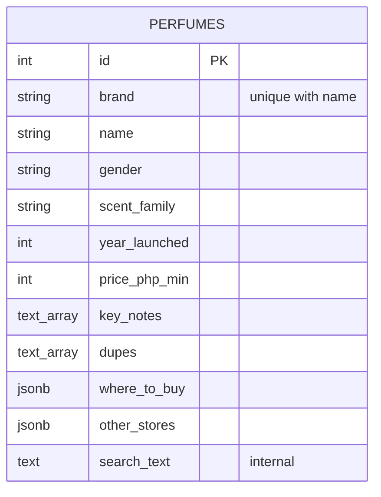

# Supabase PostgreSQL database design

One public.perfumes table uses scalar columns, text arrays and JSONB sellers. Alternative stores form an embedded one-to-many relationship because they are only read with their perfume. Independent store records and joins would add complexity without supporting a current workflow. The SQL in sql/schema.sql is prepared but has not been applied to a cloud project.

| Field | PostgreSQL type | Required | Validation / uniqueness |
|---|---|---|---|
| id | integer identity | DB assigned | Primary key; original seed IDs 1–25 |
| name | varchar(200) | Yes | Trimmed, nonempty; unique with brand |
| brand | varchar(200) | Yes | Trimmed, nonempty; unique with name |
| scent_family | varchar(20) | Yes | Amber, Floral, Fruity, Fresh, Woody, Gourmand, Leather |
| key_notes | text[] | Yes | 1–30 nonempty strings, each at most 200 chars |
| dupes | text[] | Yes | 1–30 nonempty strings, each at most 200 chars |
| gender | varchar(10) | Yes | Men, Women, Unisex |
| year_launched | integer | Yes | Strict integer, 1900 through current year |
| concentration | varchar(200) | Yes | Trimmed, nonempty |
| best_season | varchar(200) | Yes | Trimmed, nonempty |
| best_occasion | varchar(200) | Yes | Trimmed, nonempty |
| dupe_size | varchar(200) | Yes | Trimmed, nonempty |
| vibe | varchar(1000) | Yes | Trimmed, nonempty |
| dupe_price_php | varchar(200) | Yes | Display text; numeric sorting uses separate field |
| price_php_min | integer | Yes | Strict integer, 0–1,000,000 |
| where_to_buy | jsonb object | Yes | store <=200; HTTPS URL with host <=2048; note <=1000; text nonempty |
| other_stores | jsonb array | Defaults [] | 0–30 objects with nonempty store/dupe <=200 and HTTPS URL <=2048 |
| search_text | text | Trigger managed | Internal search projection, excluded from API responses |

An identity sequence allocates concurrent create IDs safely. The unique (brand,name) constraint is case-sensitive. B-tree indexes cover that pair, name, gender, scent_family and (price_php_min,id). Search uses a trigger-maintained projection and parameterized strpos(lower(search_text),lower(%s)); metacharacters are literal, and nested stores participate. This substring search scans the small catalogue. B-tree indexes do not accelerate it; benchmark trigram or full-text indexing if the catalogue grows.

API validation enforces every rule above and rejects extra fields and numeric coercion. SQL also enforces NOT NULL, uniqueness, enums, numeric ranges, basic array lengths and primary seller structure/HTTPS. It does not validate every JSON array element or text-array string length. Privileged SQL can bypass some API validation.

[SCREENSHOT: Supabase perfumes schema, constraints, indexes and seeded rows]
