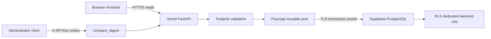
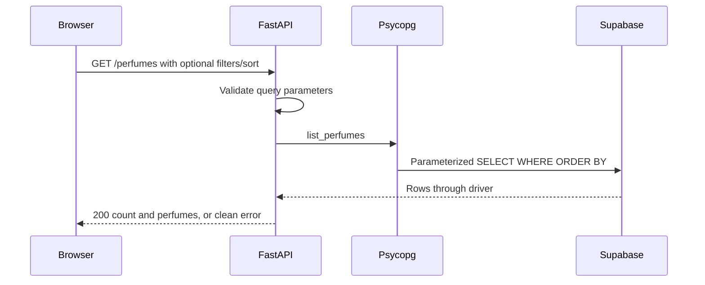
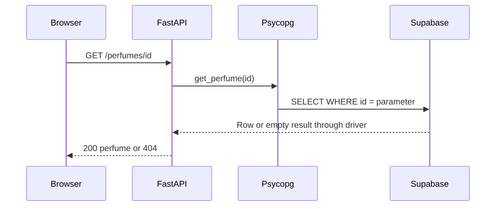

# 4 System Architecture and Integration Design

> Current status: the cloud project is now accessible and 25 records are seeded. See [cloud verification update](../cloud-verification.md) for verified results and the remaining private connection setup. Earlier statements below describe the initial implementation session.


The unchanged browser calls FastAPI only. Routes validate inputs and require ADMIN_API_KEY for writes. api/database.py uses Psycopg 3 parameterized SQL through a module-level pool with zero minimum and three maximum connections per runtime. Supavisor transaction pooling is intended for Vercel; prepared statements are disabled and TLS is required. Connection timeout is five seconds, pool acquisition eight seconds, and database statement timeout eight seconds. Successful transactions commit and exceptions roll back. No catalogue records are cached.

Psycopg directly supports identity, PostgreSQL arrays, JSONB and parameters, avoiding an ORM. psycopg-pool manages reuse; python-dotenv loads a project-root .env without overriding existing environment values. The browser receives neither a database login nor a Supabase server key. This direct PostgreSQL approach does not need Supabase API keys.

Variables: DATABASE_URL (secret URI for the sillage_api login through Supavisor), ADMIN_API_KEY (independent write credential), ALLOWED_ORIGINS (explicit comma-separated browser origins), API_BASE_URL (test runner only), TEST_RESTART_PAUSE (runner manual restart checkpoints).



## List



## Get one



## Create

```mermaid
sequenceDiagram
    Admin->>FastAPI: POST /perfumes with X-API-Key
    FastAPI->>FastAPI: Check key (401); validate body (422)
    FastAPI->>Psycopg: create(validated data)
    Psycopg->>Supabase: INSERT RETURNING, identity assigns ID
    Supabase-->>FastAPI: Committed record or error through driver
    FastAPI-->>Admin: 201 record, 409 duplicate, or clean error
```

## Update

```mermaid
sequenceDiagram
    Admin->>FastAPI: PUT /perfumes/id with full body and key
    FastAPI->>FastAPI: Check key; validate full replacement
    FastAPI->>Psycopg: replace(id, validated data)
    Psycopg->>Supabase: UPDATE input fields WHERE id RETURNING
    Supabase-->>FastAPI: Committed row or no match through driver
    FastAPI-->>Admin: 200 record, 404 absent, or clean error
```

## Delete

```mermaid
sequenceDiagram
    Admin->>FastAPI: DELETE /perfumes/id with key
    FastAPI->>FastAPI: Check key; reject unauthorized
    FastAPI->>Psycopg: delete(id)
    Psycopg->>Supabase: DELETE WHERE id RETURNING id
    Supabase-->>FastAPI: Committed deletion or no match through driver
    FastAPI-->>Admin: 204 empty response or 404
```
